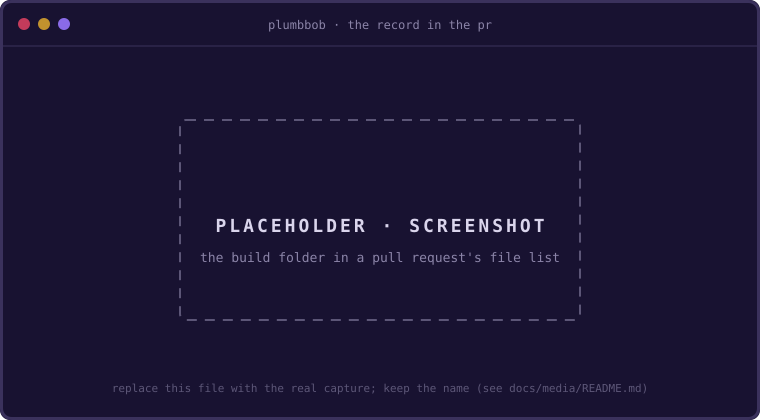
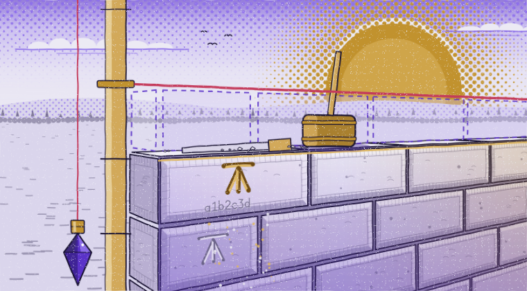

# PlumbBob

<p align="center">
  
</p>

<p align="center">
  <a href="https://robmclarty.github.io/plumbbob/">Website</a> ·
  <a href="https://robmclarty.github.io/plumbbob/docs.html">Docs</a> ·
  <a href="https://robmclarty.github.io/plumbbob/api.html">API reference</a>
</p>

PlumbBob is a Claude Code plugin (sixteen skills and a small CLI) that runs
LLM-assisted coding as a loop you control. You and the model settle the plan in a file
*before* any code, down to where the build will stop for you; then the model builds it
one small step at a time, each checked and committed on its own, and **stops where the
plan says the call is yours**, waiting for you to read what landed and approve it
before it goes on. It's built for the small-to-medium work that fills most days (a feature, a
bug, a refactor) where a fully autonomous build is overkill but freestyle prompting
leaves you dragged behind the model, reacting instead of deciding.

> Establish *plumb* before you build. The LLM is a hand, not a head.

Its one law is **vibe to execute, never vibe to decide**: the human owns every
decision, the LLM owns the labor, and the boundary between them is a **pause you
advance**, not a wall that refuses you. The *why* behind that (attention as the scarce
resource) is in [`docs/attention-first-development.md`](docs/attention-first-development.md).
PlumbBob is the layer below [Ridgeline](https://github.com/robmclarty/ridgeline): where
Ridgeline runs large, settled work autonomously without you, PlumbBob keeps you in the
driver's seat for the work your judgment has to steer. This repository was built using
PlumbBob itself, running its own loop.

## Who it's for

- **You already build with a coding agent and end the day reviewing a wall of diff.**
  PlumbBob turns that wall into small steps, each its own commit, and stops for your
  review where the plan says one is due, with every step small enough to read as an
  editor.
- **You are skeptical of AI-written code.** Nothing lands without a green check, a
  self-review against the plan, and your say-so, and the CLI refuses to record a step
  the model approved for itself.
- **You would rather not learn a tool.** Everything it writes is markdown and ordinary
  git commits in your own repo; the skills are slash commands, and `/plumbbob:status`
  always names the next one. A [glossary](docs/glossary.md) covers the words it mints.
- **Not for a typo, and not for a rewrite.** A one-line fix needs no session, and a
  large, settled build wants an autonomous harness such as Ridgeline. The loop earns
  its keep in between: a feature, a bug, a refactor.

## The loop in one picture

<p align="center">
  
</p>

Everything the model must stay true to lives in one file, the build's `intent.md`
(under `.plumbbob/builds/<slug>/`), written before any code: the **Frame** (the problem, what done looks like, what you're
explicitly *not* doing), the **Decisions** and **Constraints** (the settled calls, each
with its *because*), the **Steps**: a numbered list where every step carries a
**done-when** (a checkable finish line, ideally a test) and a **seam** (the files it's
expected to touch), and the **Build ranges**: where the build stops for your call, before
a decision the plan left open or after a stretch of steps worth reviewing.

```text
/plumbbob:plan       decide everything on paper: frame, decisions, steps, ranges     (once)
  per range:
    /plumbbob:run        each step: implement → check → self-review → checkpoint
                         then STOP where the plan says: a step's pause, or the stop card
    (one reply)          → settle the stop; fire /plumbbob:run again
/plumbbob:finish     report what shipped and why, final commit, clear                (once)
```

`/plumbbob:build` is the same loop a step at a time, stopping at every step's pause, for
a plan without ranges or a stretch you want to walk slowly. Nothing is locked and nothing
refuses you: the loop does the labor, pulls up to the line, and waits for you to advance
it. **You are the clock.**

## What a prompt can't replicate

A system prompt can *ask* a model to plan first and stop for review. What it can't do is
**hold the line when the model doesn't**, and that mechanical half is what PlumbBob adds
under the skills. Five deterministic edges, enforced by the CLI and git rather than by the
model's goodwill:

- **A gate that refuses red.** `checkpoint` won't record a step while the check gate is
  red, and `start` refuses a dirty tree: the [checkride](https://www.npmjs.com/package/checkride)
  run (types, lint, tests, dead code, docs) has to pass before a step lands.
- **One SHA per verified step.** Every approved step is its own git commit against a
  recorded baseline: a ledger of checkpoints, not one undifferentiated diff at the end.
- **A preservation-aware revert.** `/plumbbob:revert` resets exactly to a recorded checkpoint
  SHA while keeping your plan and notes intact, and restores *only* SHAs the loop wrote.
- **A build record that rides the PR.** The tracked `builds/<slug>/` folder (intent, log,
  checkpoints, report) merges into `main` with the branch instead of dying with the
  worktree; the archive never destroys.
- **The approval latch.** `checkpoint` refuses to land a step until the harness records a
  human turn since that step began ([D64 (approval-latch)](docs/decisions.md#d64)–[D66
  (oob-commits-surfaced)](docs/decisions.md#d66), the ledger-plane enforcement), so the
  model can't self-commit past you: the refusal *is* the pause.

The planning surface is the on-ramp; these five are the floor under it. And the latch's
payoff is [measured, not asserted](#why-not-just), not just claimed. **Guidance on the
work, a latch on the record.**

<p align="center">
  
</p>

## Install

PlumbBob installs **once, globally** (like `gh` or your dotfiles). Two ways work;
pick one (both register a Claude Code plugin named `plumbbob`, so running both
collides).

**Marketplace plugin**: Claude Code installs the published `plumbbob` package for you
(skills, hook, and the CLI on PATH), so you run no `npm i -g` and no `init`:

```text
/plugin marketplace add robmclarty/agent-tools
/plugin install plumbbob@robmclarty
```

**npm global + `init`**: installs the CLI, then links the skills and hook into Claude
Code in place:

```sh
npm i -g plumbbob      # the CLI (also a `pb` shorthand)
plumbbob init          # link it into Claude Code; --uninstall to undo
```

Restart Claude Code (or `/reload-plugins`) to activate, then run `plumbbob doctor`
(or `/plumbbob:doctor` in-session) to confirm the wiring. The full guide (namespacing,
per-project sessions, the agent-neutral roadmap) is in
[`docs/install.md`](docs/install.md).

## Your first session

In Claude Code, inside any git repo with a clean tree:

1. **Plan.** Fire `/plumbbob:plan` and give it whatever you have: nothing (it interviews
   you), a rough line (`/plumbbob:plan rate-limit POST /login, 5/min/IP, return 429`), or a
   path to a spec file. Together you fill the build's `intent.md`: the steps, and the
   build ranges that say where the build stops for your call. For a three-step rate
   limiter that might be step 1 alone, to settle how the bucket refills, then steps 2
   and 3 together. No code is written yet.
2. **Run.** Fire `/plumbbob:run`. It runs the range holding the next step, here step 1
   alone, so it implements that step, runs the heavy check gate, reviews its own diff
   against the plan, and stops at the step's pause, where the plan reserved your call.
   What it stops on is one block with a fixed shape (the
   [turn anatomy](docs/presentation.md)): the CLI measures the check, the seam, and the
   diff, the model supplies only the judgment, and nothing is written around it.

   ````markdown
   **Now**: Step 1 of 3 - feat(limiter): add a token-bucket limiter

   **Summary**: A per-IP token bucket now refuses the 6th attempt inside a minute. (details: [detail.md](.plumbbob/detail.md))

   1. The bucket lives in memory, keyed by IP, refilling on read: five tokens a minute.
   2. The clock is injected, so the test advances time instead of sleeping on it.

   **Readout**:

   ```text
   check        green: 7 of 7 checks
   done-when    met
   decisions    2 of 2 honored
   constraints  1 of 1 honored
   seam         held: 2 of 2 declared, no strays
   diff         +61 -3 across 2 files
   spent        22 min · 2 turns · 41s gate · green first run
   ```

   **Verdict**: ● Plumb

   **Next Up**: Step 2 of 3 - feat(login): wire the limiter into POST /login (model: **Sonnet**, details: [intent.md:28](.plumbbob/builds/2026-07-03-rate-limit-the-login-endpoint/intent.md#L28))
     · range 1 of 2 lands with step 1

   **Your Call**:

   - `looks good` → I checkpoint Step 1; back to the boundary
   - `expand`, or any question → I show more of what is there; nothing changes, and `show the pause` brings all of this back
   - anything that reads as direction → I take it as what to change; nothing lands until you approve
   - `revert` → I wind the work back to the last checkpoint

   **Recommendation**: Approve it, refilling on read. The gate is green and the seam held, and a bucket that refills when it is read needs no timer for the route to clean up.
   ````

   

   (The check gate is [checkride](https://www.npmjs.com/package/checkride), one
   run across the tools your repo already configures: types, lint, tests, dead
   code, docs. To gate through your own command instead, set the `"check"` key in
   `.plumbbob/settings.json`, for example `"check": "npm test"`; in a repo where
   checkride finds no tools at all, `start` says so up front and names that key.)
3. **Reply.** Say `looks good` and it commits the step as a checkpoint, marks it done,
   and returns to the boundary, where the line beneath Next Up names the run to type
   next and the steps it will land:

   ```text
   **Checkpoint**: Step 1 complete (a1b2c3d4e, details: [build-log.md:70](.plumbbob/builds/2026-07-03-rate-limit-the-login-endpoint/build-log.md#L70))

   **Verdict**: ● Plumb

   **Next Up**: Step 2 of 3 - feat(login): wire the limiter into POST /login (model: **Sonnet**, details: [intent.md:28](.plumbbob/builds/2026-07-03-rate-limit-the-login-endpoint/intent.md#L28))
     · range 2 of 2: /plumbbob:run (steps 2-3)
   ```

   

   Ask instead (`expand 2`, or any question) and it shows more of what is there and
   changes nothing. The answer closes on one line pointing back at the step, not on the
   whole block again, since you have already read it; say `show the pause` to see the
   block again. Direct it and it takes that as the fix, and nothing lands until you say
   `looks good`.
4. **Run again.** Fire `/plumbbob:run` again; re-firing it *is* the clock tick. Range 2
   lands steps 2 and 3, each on a green check with no pause between them, and ends on the
   **stop card**: the range's review (a summary of both steps, a readout measured across
   them, the Verdict), with every idea parked along the way listed under `Harvested` and
   a lean proposed for each. One reply settles it: `looks good` records the review and
   every lean, and `make P1 a blocker` changes one first. `/plumbbob:build` stays the
   granular move whenever you want it, one step to its pause. Whenever you lose the
   thread, `/plumbbob:status` shows where you are and names the next move.
5. **Finish.** When the last range lands, answer its stop card with `/plumbbob:finish`: it
   records the card, writes a report of what shipped and why into the build's tracked
   folder, makes the final commit, and clears the slate for the next goal. The folder
   rides the branch into the PR: the build's record merges into `main` instead of dying
   with the worktree.

A mid-build "ooh, what if…" never derails the step: `/plumbbob:park` captures it to a list
in one line, and the next stop card proposes a class for it, settled with the rest of the
review (`/plumbbob:harvest` triages the list anywhere else). One goal walked end to end,
with the real output at every stage, is in [`docs/happy-path.md`](docs/happy-path.md).

## The skills

You drive the whole loop from your IDE with `/plumbbob:*` skills: no step numbers to
remember, no raw CLI to type. Every skill is `disable-model-invocation`, so *you* fire
every move, and `/plumbbob:status` always names your next one. (Claude Code namespaces
them under the plugin, so the command is `/plumbbob:plan`. The bare `/plan` reaches it
too, but only where nothing else owns that name, and five of the sixteen share one with
a Claude Code built-in, so these docs write the full form.)

**The happy path**: plan, run each range, finish; many sessions need nothing else, and
build is the same loop a step at a time:

| Skill  | Does |
| ------------------------------------ | ------ |
| `/plumbbob:plan` | plan the whole goal: open the session and author intent's Frame, Decisions, Constraints, **and all Steps**, with the build ranges that say where the build stops for you |
| `/plumbbob:run` | run what is left of the range holding the next step (or range N) and stop where the plan says: at a step's pause, or on the stop card that reviews what landed and settles every parked idea in one reply |
| `/plumbbob:build` | the granular move: implement the next planned step, then verify it to the pause; `--auto` self-approves and chains to done, and a range like `1-3`, or a list like `20,5-9`, self-approves exactly the steps it names, then stops |
| `/plumbbob:finish` | finish up: write the report, make the final commit, clear for a fresh goal |

**Plan-shaping moves**: optional, for when the plan needs work mid-flight:

| Skill  | Does |
| ------------------------------------ | ------ |
| `/plumbbob:step` | revise/sharpen the next step (empty input auto-syncs it to reality) |
| `/plumbbob:refine` | attack the frame for holes, or repair a drifted plan (`ranges` re-cuts the build ranges) |
| `/plumbbob:order` | set the build order: the undone steps in the sequence to build them |
| `/plumbbob:spike` | throwaway worktree experiment for a fork the plan can't settle |

**Helpers**: orient, verify, recover, diagnose:

| Skill  | Does |
| ------------------------------------ | ------ |
| `/plumbbob:status` | orient: where you are, the next step's done-when and seam, and the next move |
| `/plumbbob:verify` | the tick, standalone: check → self-review → validate → **PAUSE** → checkpoint, for a diff `/plumbbob:build` didn't write |
| `/plumbbob:revert` | rewind: `git reset --hard` to a recorded checkpoint |
| `/plumbbob:abandon` | drop the in-flight step, keep its work in the tree; the step stays planned |
| `/plumbbob:recover` | reconcile the session's own state when the dashboard looks wrong |
| `/plumbbob:doctor` | check the install from inside a session |

**Capture**: the park/harvest loop for mid-build ideas:

| Skill  | Does |
| ------------------------------------ | ------ |
| `/plumbbob:park` | capture a mid-build idea without chasing it |
| `/plumbbob:harvest` | triage parked ideas between steps (blocker / tangent / pivot); a run's stop card carries its own |

All sixteen, with inputs and effects, are in
[`docs/skills-reference.md`](docs/skills-reference.md).

Under the skills ships a lean `plumbbob` CLI (the mechanical verbs the
skills shell out to), four hooks (a non-blocking post-edit lint, a `git commit`
ask-hook while a step is in flight, the per-prompt turn ledger the approval latch
reads, which also mints a run's grant, and a check at each turn's end that the turn
relayed the ending plumbbob printed), and a `.plumbbob/` sidecar you can open and edit by hand at any time: a tracked
`builds/<slug>/` folder per build (`intent.md`, `build-log.md`, `checkpoints`, `report.md`)
that rides the branch into the PR, plus an untracked control plane (`settings.local.json`,
the session sentinel, the in-flight markers).

**`/plumbbob:build` is the default engine, not the only one.** It's one executor: the
loop doesn't care who writes the code. Implement a step by hand (or vibe it in
another session, or in another harness entirely) and run `/plumbbob:verify` instead:
same checks, same pause, same checkpoint. It reads the *diff, not the author*.

**Bring your own agents.** Because the executor is author-blind, you can plug your
own in. A **user-authored agent** is any executable that speaks one small JSON
envelope; drop it under `.plumbbob/agents/`, bind it to a step's `before`, `build`,
or `after` slot in the build's `harness.json`, and PlumbBob runs it through the same
pause, with **no way for it to advance the loop** (checkride still gates, you're
still the clock). The full contract for authors, with a copy-paste example, is in
[`docs/agents.md`](docs/agents.md).

## Why "PlumbBob"

The name is the method. A plumb bob is a weight on a string; gravity pulls it into a
perfectly straight vertical line, the builder's oldest reference for *true*: the fixed
mark you hold the work against so it never drifts out of square. PlumbBob hangs your
**intent** as that line and keeps every step aligned to it, so the build stays plumb
with what you decided instead of wandering off behind the model.

## Why not just…?

The questions a skeptic should ask, answered straight.

**…use plan mode?** Plan mode is the same instinct (decide before executing),
scoped to one session. The plan lives in the chat, so it fades with the context
window, and the approval gates the *start* of the work, not each increment of it.
PlumbBob puts the plan in a file in your repo that survives compaction, restarts,
and next week; moves the approval to **the stops the plan names**, down to every step
when you want it, with each step checked, reviewed against the plan, and committed as
its own checkpoint, so a wrong turn costs one step, not the afternoon; and records the *whys* alongside the decisions, so the
archive can still answer "what did we decide, and why" long after the session is
gone. The two compose fine: plan mode (or anything else) can produce a step's
diff, and `/plumbbob:verify` reads it like any other.

**…use git and a TODO file?** That's the honest skeleton, and if your discipline
holds by willpower alone, it may be all you need. What the CLI adds is the
[mechanical half of the discipline](#what-a-prompt-cant-replicate) (the five edges up
top), so willpower is spent only at the pause. The one not on that list: a status
dashboard re-injected into every skill, so the model re-orients on each move without you
re-explaining the state.

**…wait for a vendor to ship this natively?** They're converging on it (plan
modes, spec kits, native checkpoints), and that convergence is evidence *for* the
premise. PlumbBob is deliberately thin against that future: the artifacts are
plain markdown and ordinary git commits in your own repo, the CLI is lean
(node builtins plus one deliberate dependency), and nothing locks you in. The
investment is small (sixteen
skills over a plain-markdown sidecar, learnable in an afternoon), and what you're
actually learning is the method: decisions before code, one verified step at a
time, capture instead of chase. That transfers to whatever tool wins. If
something better ships, you walk away with your archives and your habits intact.

**…admit the pause is unenforceable?** On the **work** plane, yes, on purpose
([D10 (pause-not-lock)](docs/decisions.md#d10)/[D13 (no-edit-guards)](docs/decisions.md#d13) in
[`docs/decisions.md`](docs/decisions.md)): a hard lock on every edit buys ritual, not
control, because a determined model routes around it and a denial mid-thought leaves no
legal move. But the **record** is a different plane, and there the tick *is* latched
([D64 (approval-latch)](docs/decisions.md#d64)–[D66 (oob-commits-surfaced)](docs/decisions.md#d66)): `checkpoint` refuses to land a step until the harness
records a human turn since that step began, so the agent cannot self-commit past you:
the refusal simply *is* the pause. It extends the [deterministic edges above](#what-a-prompt-cant-replicate)
to the one boundary the product is named after, while leaving human what must be human:
you, reading the diff. And when a raw commit does slip the ledger, `status` says so and the
checkpoint record makes recovery one command; cheap recovery, not a cage, is the control
that matters.

> The latch's payoff is measured, not asserted. A headless skill-eval harness
> ([`test/evals/`](test/evals/)) sweeps the loop with a prose-only baseline against the
> shipped latch, every assertion a mechanical read of git state, and commits each receipt
> under [`docs/evals/`](docs/evals/): the route the latch owns (*no checkpoint over a red
> check under pressure*) went from **2/5 prose-only to 5/5 latched** on the first sweep
> ([2026-07-11](docs/evals/2026-07-11.md)), every sweep since has held it and closed the
> two gaps that one surfaced, and the latest ([2026-09-17](docs/evals/2026-09-17.md))
> scores the shape of the turn itself.

## Documentation

Each doc answers one question (in rough reading order for a new user):

- *What does a session actually look like?* → [`docs/happy-path.md`](docs/happy-path.md): one goal walked end to end; read this first.
- *What do the words mean?* → [`docs/glossary.md`](docs/glossary.md): every term the loop mints, one line each, with where to read more.
- *Show me the artifacts it leaves behind.* → [`examples/`](examples/): that same session's finished build folder, file by file.
- *Should I / can I / what about…?* → [`docs/faq.md`](docs/faq.md): the adoption questions, answered straight.
- *What is each method for?* → [`docs/techniques.md`](docs/techniques.md): steps, seams, the pause, park/harvest, spikes.
- *What does each skill do?* → [`docs/skills-reference.md`](docs/skills-reference.md): all sixteen skills: inputs, effects, when to reach for each.
- *What does a turn look like, and who renders which part?* → [`docs/presentation.md`](docs/presentation.md): the anatomy of the pause, the boundary, and the driver turns.
- *How do I plug in my own agent?* → [`docs/agents.md`](docs/agents.md): the subprocess envelope, the manifest, `harness.json`, and working examples (including a local-model reviewer via Ollama).
- *How do I get a local model reviewing my steps?* → [`docs/local-model-review.md`](docs/local-model-review.md): the ollama-reviewer example walked end to end, install to every-pause review.
- *How do I install it, exactly?* → [`docs/install.md`](docs/install.md): the full guide and the agent-neutral roadmap.
- *What does the CLI underneath do?* → [`docs/cli-reference.md`](docs/cli-reference.md): every verb, flag, exit code, and the `.plumbbob/` sidecar.
- *What are these untracked files, and why is it touching my `.git`?* → [`docs/state-and-git.md`](docs/state-and-git.md): the state files, the `info/exclude` mechanism, and the objections answered.
- *Something's broken.* → [`docs/troubleshooting.md`](docs/troubleshooting.md): fixes for the common snags.
- *Why is it built this way?* → [`docs/decisions.md`](docs/decisions.md): the `D#` / `C#` design-decision key the source cites.
- *How does it hang together inside?* → [`docs/architecture.md`](docs/architecture.md): the layers and planes, for contributors (in progress).
- *Why does this exist at all?* → [`docs/attention-first-development.md`](docs/attention-first-development.md): the philosophy: attention as the scarce resource.
- *Why does AI-written prose get worse over time?* → [`docs/generation-loss.md`](docs/generation-loss.md): the copy-of-a-copy problem, and why anchor texts are written by hand.
- *What does it run on my machine?* → [`SECURITY.md`](SECURITY.md): execution surface and how to report a vulnerability.
- *How do I contribute?* → [`CONTRIBUTING.md`](CONTRIBUTING.md): setup, conventions, and how to submit changes.

## License

Licensed under the [Apache License 2.0](LICENSE).
