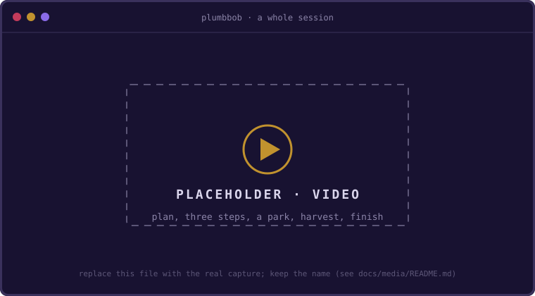
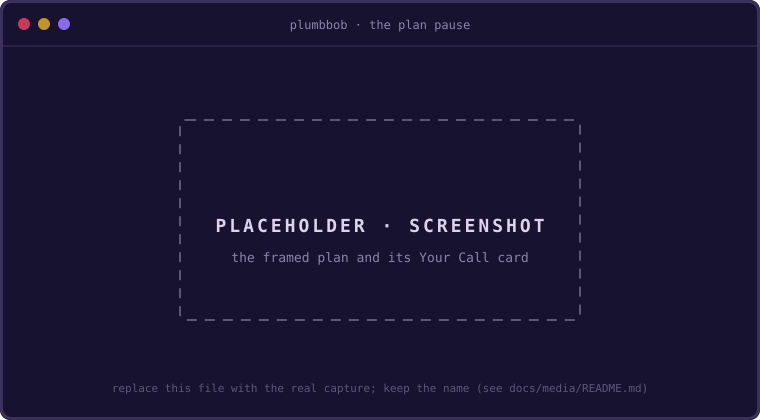
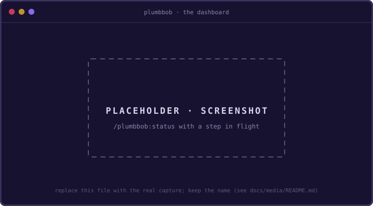
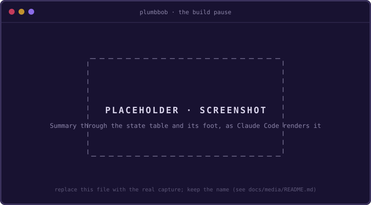
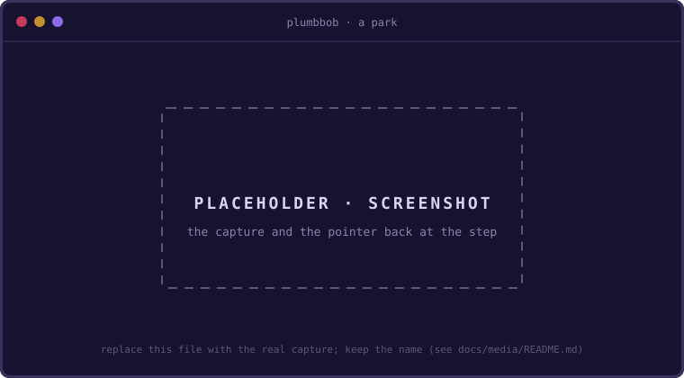
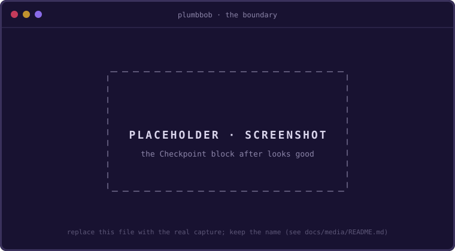
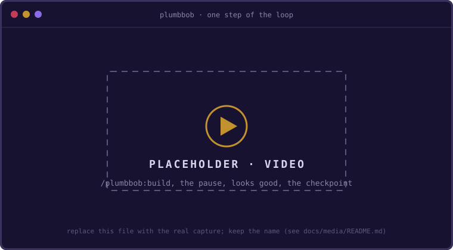

# The happy path: one complete cycle

This is the workflow end to end: from planning a fresh goal **all at once**, through
running it range by range with `/plumbbob:run` until done, to finishing up and starting
the next task. It's a worked example, not reference docs: every command, dashboard, and
CLI line below is what you actually see.

The loop in one breath: **`/plumbbob:plan` once to author the whole plan and the ranges
that say where it stops for you, then fire `/plumbbob:run` per range (each lands what its
range names and stops where the plan reserved your call: at a step's pause, or on the stop
card that reviews what landed and proposes a class for every parked idea), settle each stop
in one reply, then `/plumbbob:finish` once.** `/plumbbob:build` is the same loop a step at a
time, for a plan without ranges or a stretch you want to walk slowly. In the loop you never
type the `plumbbob` CLI by hand; the skills shell out to it (only install, `plumbbob init`
and `doctor`, is manual; even `plumbbob start` is run for you by `/plumbbob:plan`), and
`/plumbbob:status` always names your next move. The run on its own (a longer plan, a
blocker that re-cuts a range and moves the build order, and the same plan driven by hand
beside it) is in [`runs.md`](runs.md).

> The example goal: **rate-limit the login endpoint**, a small feature touching a
> couple of modules, big enough to show the full cycle.



---

## 0. Plan the whole goal: `/plumbbob:plan`

The deciding happens *before* any code, on a surface outside the chat. `/plumbbob:plan`
scaffolds the session and authors the **complete** `intent.md` (Frame, Decisions,
Constraints, **all the Steps**, and the build ranges), so the build afterward is just
`/plumbbob:run` until done. It writes intent only, never source.

It takes whatever seed you give it and disambiguates the mode itself (no quotes
required):

```text
/plumbbob:plan                                  # interview: Q&A draws the plan out of your head
/plumbbob:plan docs/rate-limit-spec.md          # absorb an out-of-band spec into intent.md
/plumbbob:plan rate-limit POST /login, in-memory bucket, 5/min/IP, 429   # expand inline intent
```

Under the hood it runs `plumbbob start`, which records a baseline and drops you in
`DESIGN`:

```text
**Session**: started "Rate-limit the login endpoint" (baseline 3a1f2b0c1)
  → frame and decide in .plumbbob/builds/2026-07-03-rate-limit-the-login-endpoint/intent.md, then build a step
```

In interview mode it proposes wording you can accept without typing ("done-when: the
6th request in 60s returns 429, good?") and takes as much detail as you want to give.
The result is a plan an agent can follow, with **every step carrying a done-when and a
seam**, and the build ranges last:

```markdown
# Rate-limit the login endpoint

## Frame
- **Problem:** the login route has no throttle; credential-stuffing is cheap.
- **Smallest thing that solves it:** a per-IP token bucket on POST /login.
- **Done looks like:** the 6th attempt inside a minute returns HTTP 429.
- **Explicitly NOT doing:** distributed/multi-instance limits; CAPTCHA.

## Decisions
- <a id="d1"></a>**D1 (in-memory-bucket)**: in-memory token bucket, *because* single instance today; defer Redis.
- <a id="d2"></a>**D2 (five-per-minute)**: 5 attempts / 60s / IP, *because* it matches the existing lockout policy.

## Constraints
- <a id="c1"></a>**C1 (no-new-deps)**: no new runtime dependencies.

## Steps
1. [ ] feat(limiter): add a token-bucket limiter, **done when:** `test/limiter.test.ts` passes
   - seam: `src/limiter.ts`, `test/limiter.test.ts`
   - model: opus (strong-assertion test authoring)
2. [ ] feat(login): wire the limiter into POST /login, **done when:** the 6th request in 60s returns 429
   - seam: `src/routes/login.ts`, `test/login.rate.test.ts`
   - model: sonnet (mechanical wiring, fully specified)
3. [ ] feat(config): make the limit configurable via env, **done when:** `RATE_LIMIT_MAX` overrides the default in a test
   - seam: `src/limiter.ts`, `src/config.ts`, `test/limiter.config.test.ts`

## Build ranges

Run step 1 alone to settle how the bucket refills, then run the rest straight through.

1. `/plumbbob:build 1`, **stop:** at step 1's pause, pick refill-on-read or a timer before the route leans on it
   - model: opus
2. `/plumbbob:build 2-3`, **stop:** try six logins yourself, then `/plumbbob:finish`
   - model: sonnet
```

The build ranges say where the build stops for you, one item per range: the command that
defines it, the call that ends it, and the model to run it on. A range ends where a call is
due and nowhere else. A bare `1` builds step 1 to its pause, so the refill call is made
there, before the step lands; a span lands every step it names and stops after the last,
for a review of what landed. You never type these commands: the card names the run to type
instead, and a range grants nothing until you type it.

The plan pause is a decision turn like the build pause. The skill presents the framed
plan, gives it a cold read (one adversarial pass under `/plumbbob:refine`'s lens,
surfacing holes without writing any), and writes that read into `.plumbbob/detail.md`;
then it relays the CLI's plan-pause card (`plumbbob handoff --plan`), which opens on a
rule because the plan itself sits above it. Nothing is measured yet, so it carries no
Verdict, and the state table at its foot is headed by Next Up instead; nothing has
landed, so `revert` is not among the moves. The recommendation is the cold read's
verdict: `Approve it`, or `Sharpen <the worst hole> first` with refine named for the
rest, and the card closes on one link to the read itself:

```text
---

**Your Call**:

- `looks good` → I mark the plan decided; /plumbbob:run runs range 1 from Step 1
- `expand`, or any question → I show more of what is there; nothing changes
- anything that reads as direction → I take it as what to sharpen; the plan is cheap to change now

| **Next Up** | Step 1 of 3 - feat(limiter): add a token-bucket limiter (model: **Opus**, details: [intent.md:25](.plumbbob/builds/2026-07-03-rate-limit-the-login-endpoint/intent.md#L25)) |
| --- | --- |
| Range | 1 of 2: /plumbbob:run (step 1 to its pause) |

**Recommendation**: Approve it. Every step carries a done-when a test can measure, the seams name files that exist, and each Decision states its because.

[more details](.plumbbob/detail.md)
```



On `looks good` the skill commits the plan on its own (`plumbbob checkpoint --plan`), so
the first step's diff stays clean and history reads baseline, plan, steps. The commit
prints its own close:

```text
**Plan**: committed (7d2e94fb0, details: [build-log.md:62](.plumbbob/builds/2026-07-03-rate-limit-the-login-endpoint/build-log.md#L62))

| **Next Up** | Step 1 of 3 - feat(limiter): add a token-bucket limiter (model: **Opus**, details: [intent.md:25](.plumbbob/builds/2026-07-03-rate-limit-the-login-endpoint/intent.md#L25)) |
| --- | --- |
| Range | 1 of 2: /plumbbob:run (step 1 to its pause) |
```

> **Plan as far as you can see clearly.** Later steps may be fuzzier than the first;
> that's fine; they get sharpened just-in-time when you reach them. Before building,
> you can hand the frame to `/plumbbob:refine` to attack it for holes (or repair the plan
> later if a build contradicts it).

---

## 1. Review the plan: `/plumbbob:status`

Before building, glance at what's next. `/plumbbob:status` is read-only; it prints the
dashboard, surfaces the **next step's done-when, seam, and model recommendation** so
you can sanity-check it (and switch models before building, if you agree with the
recommendation), lists the ranges with their stops, and names the single next move:

```text
PlumbBob — Rate-limit the login endpoint   [DESIGN]

  steps  0/3 done
  ▸ 1  feat(limiter): add a token-bucket limiter   ← next
        done when: `test/limiter.test.ts` passes
        seam: src/limiter.ts, test/limiter.test.ts
        model: opus (strong-assertion test authoring)
    2  feat(login): wire the limiter into POST /login
    3  feat(config): make the limit configurable via env

  ranges  0 of 2 done
  ▸ 1  /plumbbob:build 1 · opus   ← next
        stop: at step 1's pause, pick refill-on-read or a timer before the route leans on it
    2  /plumbbob:build 2-3 · sonnet
        stop: try six logins yourself, then `/plumbbob:finish`

last checkpoint  none yet
parked 0 · open questions 0

next → run range 1 of 2 — `/plumbbob:run` (step 1 to its pause)
```



Each range row is the command the plan wrote, `✓` once every step in it has landed and `▸`
on the one holding the next step, with its stop beneath. A step `/plumbbob:step` or
`/plumbbob:refine` adds goes into a range, and a range the plan has outgrown is flagged
rather than rewritten.

---

## 2. Sharpen the next step (optional): `/plumbbob:step`

The steps were planned up front, so `/plumbbob:step` is now a *revision* tool, not the way
steps are born. If the next step still looks right, skip it. If something changed,
fire it:

- **`/plumbbob:step` (no input)** auto-sharpens the next step: it re-reads what you've
  already built, the Decisions, and the Constraints, and syncs the step's done-when and
  seam to reality. The zero-effort "keep my next step honest" move.
- **`/plumbbob:step <what changed>`** makes a directed revision: tighten the done-when,
  adjust the seam, or split the step.

You approve the change; it's written back into `## Steps`. Most steps need nothing:
straight to `/plumbbob:run`.

---

## 3. Run the first range: `/plumbbob:run`

`/plumbbob:run` runs what is left of the range holding the next step. You type no step
numbers, because the plan knows them: the turn hook mints the run's grant from the plan as
you type the verb, and `/plumbbob:run 2` would name range 2 by its number instead.

```text
/plumbbob:run
```

The skill opens on a run header naming what it will do:

```text
run  range 1 of 2 · step 1 · ends at step 1's pause
     stop: at step 1's pause, pick refill-on-read or a timer before the route leans on it
     grant: none, as a bare range builds to its pause
```

Range 1 is a bare range, so the run builds step 1 the way `/plumbbob:build` would and
stops at its pause, where the plan reserved the refill call. It reads the step's
done-when, seam, Decisions, and Constraints, implements *only that step*, and goes
in-flight, recording the seam for orientation (not a lock):

```text
plumbbob: building step 1
plumbbob: the seam is orientation, not a lock (2 paths)
  src/limiter.ts
  test/limiter.test.ts
```

It writes the code, runs the heavy gate, self-reviews the diff against the plan, and
then **stops at the pause**: the one human-convergence beat. Nothing is committed yet.
The whole turn is one block. The agent writes its judgment into `.plumbbob/detail.md`,
`plumbbob handoff` renders the turn from that file and its own measurements, and the
agent pastes the result and writes nothing around it (the
[turn anatomy](presentation.md) fixes every part of the shape):

````markdown
**Summary**: A per-IP token bucket now refuses the 6th attempt inside a minute.

**Readout**:

```text
check        green: 7 of 7 checks
done-when    met
decisions    2 of 2 honored
constraints  1 of 1 honored
seam         held: 2 of 2 declared, no strays
diff         +61 -3 across 2 files
             - src/limiter.ts +38 -3
             - test/limiter.test.ts +23 -0
spent        22 min · 2 turns · 41s gate · green first run
```

**Your Call**:

- `looks good` → I checkpoint Step 1; back to the boundary
- `expand`, or any question → I show more of what is there; nothing changes, and `show the pause` brings all of this back
- anything that reads as direction → I make the change and say what moved; nothing lands until you approve
- `revert` → I wind the work back to the last checkpoint

| **Verdict** | ● Plumb |
| --- | --- |
| Now | Step 1 of 3 - feat(limiter): add a token-bucket limiter |
| Next Up | Step 2 of 3 - feat(login): wire the limiter into POST /login (model: **Sonnet**, details: [intent.md:28](.plumbbob/builds/2026-07-03-rate-limit-the-login-endpoint/intent.md#L28)) |
| Range | 1 of 2 lands with step 1 |

**Recommendation**: Approve it, refilling on read. The gate is green and the seam held, and a bucket that refills when it is read needs no timer for the route to clean up.

[more details](.plumbbob/detail.md)
````



Every deterministic line there is measured, not composed: the check row comes from the
gate's own summary, the seam row from the declared seam against `git diff`, the diff
row and the files beneath it and the `spent` row from git and the step's receipts, and
the Verdict, which heads the state table, is the worst of them all. Only the Summary,
the three judgment rows, and the recommendation are the agent's, and they reach the turn
through the detail file rather than the chat. The rest of the agent's story (the numbered
sections behind the Summary) stays in that file, one `more details` link away. The
recommendation speaks to the call the plan reserved here, and the Range row says range 1
ends with this step.

The four moves are the ones you actually make. `expand 2` (or any question at all) opens
the matching section of the detail file and changes nothing. The answer closes on one
line, not on the whole block again, because you have already read the block and 40
lines beneath an answer push it off the screen:

```text
**Next Up**: Back to Step 1 of 3 - feat(limiter): add a token-bucket limiter
```

Anything that reads as direction is a reply too: the agent makes the change, says what
moved and what the check found, and closes on that same line, and still nothing lands
until you say `looks good`. The block comes back only when you say `show the pause`
([D110 (reply-after-the-card)](decisions.md#d110)).

> **This pause is the product.** You read the diff and say "yes, this matches what I
> intended." It reads the *diff, not the author*: a step you wrote by hand or vibed in
> another session verifies exactly the same way (see *The pluggable executor* below).
>
> **The latch makes the pause real.** Nothing ever blocks an edit (the work plane is
> pure guidance), but the *record* is latched: when the session runs under plumbbob's
> turn hook, `checkpoint` refuses to land a step in the same turn it began, so the agent
> **cannot** self-checkpoint past you. That refusal *is* this pause: the agent presents
> the diff and ends its turn, and **your next message is the tick** that lets the
> checkpoint land. You don't have to trust the agent to stop; the ledger stops it. (Type
> the grant by name, `/plumbbob:run` over a range that lands its steps,
> `/plumbbob:build --auto`, or a range like `1-3` or `20,5-9`, and you grant it
> self-approval for those steps; that grant can only come from a prompt *you* typed. See
> [D64 (approval-latch)](decisions.md#d64)–[D66 (oob-commits-surfaced)](decisions.md#d66).)

---

## 4. Park strays mid-build: `/plumbbob:park`

The moment an "ooh, what if" arrives mid-step, you **capture it, you don't chase it**.
Say while reading step 1's pause you think *"should password reset be throttled too?"*;
hand it to `/plumbbob:park`, inline or bare:

```text
/plumbbob:park should /password-reset get the same throttle?   # pass the idea inline
/plumbbob:park                                                  # or fire it bare — it uses the idea you just raised
```

`/plumbbob:park` never writes the line blind: it **composes one tidy, tagged line and shows it to
you for a quick OK** (confirm it as-is or tweak the wording), then captures it by shelling
`plumbbob park` under the hood. A park is a driver turn: the capture, then one pointer
back at the step it interrupted, and nothing else. The verb prints both, so the relay is
one command's output here too.

```text
**Parked**: should /password-reset get the same throttle? (tangent)

**Next Up**: Back to Step 1 of 3 - feat(limiter): add a token-bucket limiter
```



It's on the list, out of your head, and the step in flight stays protected. The
dashboard now counts it:

```text
parked 1 of 1 open · open questions 0
```

Inside a run, the model parks what it meets the same way, with `plumbbob park`, and keeps
building. Nothing triages the list mid-range; the parks wait for the range's stop.

---

## 5. Run the next range to its stop card: `/plumbbob:run`

Back at step 1's pause, you approve. Only then does it checkpoint: committing the work,
recording the SHA, flipping the step to `[x]`, and returning to the `DESIGN` boundary,
where it **stops**. The boundary turn scales the anatomy down to what a landed step needs:
the lead line, then the state table (the Verdict, Next Up, and the rows beneath it), with
no Your Call block, because no decision is pending. `plumbbob checkpoint` prints it all
itself, as one block, so what the agent relays is one command's output:

```text
**Checkpoint**: Step 1 complete (a1b2c3d4e, details: [build-log.md:70](.plumbbob/builds/2026-07-03-rate-limit-the-login-endpoint/build-log.md#L70))

| **Verdict** | ● Plumb |
| --- | --- |
| Next Up | Step 2 of 3 - feat(login): wire the limiter into POST /login (model: **Sonnet**, details: [intent.md:28](.plumbbob/builds/2026-07-03-rate-limit-the-login-endpoint/intent.md#L28)) |
| Range | 2 of 2: /plumbbob:run (steps 2-3) |
| Parked | 1 of 1 open |
```



The `details:` pointer is where the pause's record went: `checkpoint` writes the block
you approved beneath the step's dated line in `build-log.md`'s Log, so an older step's
detail is a scroll, and the record rides the branch into the PR.

That Next Up row is what carries the plan's model recommendation across a context
window: a fresh window inherits the session's model rather than the plan's suggestion, so
the row names the `/model` to select before the next run, the range's own when a run
comes next. Guidance, never a gate.

The Range row beneath it names the run to type, and the steps it will land. **Fire
`/plumbbob:run` again**: *re-firing it is the clock tick*. The hook mints `steps 2-3` from
the plan as you type, and the header says so:

```text
run  range 2 of 2 · steps 2-3 · ends at step 3's boundary
     stop: try six logins yourself, then `/plumbbob:finish`
     grant: steps 2-3
```

Range 2 lands both steps without a pause between them. Each still runs the whole tick but
the pause (the check, the self-review against the plan, and a checkpoint of its own), so a
wrong turn still costs one step to revert, and a red check or a mismatch halts the run at
that step's pause, on the same card as step 1's. When step 3 lands, the run ends on the
**stop card**: a review of the whole range written from the steps' commits, a Readout
measured across both landings, every open park as a row of the lean table with a lean
proposed for it, and the plan's stop for range 2 in the state table at its foot:

````markdown
**Summary**: POST /login now answers the 6th attempt inside a minute with 429, and `RATE_LIMIT_MAX` moves the limit.

**Readout**:

```text
steps        2 of 2 landed
             - 2 b2c3d4e · 3 e5f6a7b
check        green: 7 of 7 checks, 2 landings
done-when    met
decisions    2 of 2 honored
constraints  1 of 1 honored
seam         held: 2 of 2 steps, no strays
diff         +48 -6 across 5 files
             - .env.example +1 -0
             - src/config.ts +9 -0
             - src/routes/login.ts +14 -6
             - test/config.test.ts +11 -0
             - test/login.rate.test.ts +13 -0
spent        31 min · green first run at every landing
```

**Harvested**: 1 of 1 parked idea open

| Park | What it is | Why it matters | Lean |
| --- | --- | --- | --- |
| P1 · reset throttle | should /password-reset get the same throttle? (tangent) | it is the next brute-force target once login is closed | tangent: a separate route and a separate decision, not a blocker for this goal |

**Your Call**:

Approving locks in each lean above; to change one, say so first (`make P1 a blocker`).

- `looks good` → I record the review and every lean as proposed, folding a blocker into the plan; back to the boundary
- `/plumbbob:finish` → I record them the same way, then write the report and close the build
- anything that reads as direction → I change the lean and say what moved; nothing is recorded until you approve
- `expand`, or any question → I show more of what is there; nothing changes, and `show the stop` brings all of this back

| **Verdict** | ● Plumb |
| --- | --- |
| Stop | Range 2 of 2 landed - try six logins yourself, then `/plumbbob:finish` (details: [intent.md:42](.plumbbob/builds/2026-07-03-rate-limit-the-login-endpoint/intent.md#L42)) |
| Next Up | Nothing planned - /plumbbob:step or /plumbbob:finish |

**Recommendation**: Approve it, then try six logins yourself before you finish. The gate was green at both landings, and the one park is future work, not this goal's.

[more details](.plumbbob/detail.md)
````

The Harvested part is the harvest. No harvest ran between the steps, so every idea parked
along the way is here, as a row of the lean table: its handle (`P1`, the first line ever
parked) and a short title, its text as you parked it, why it matters, and the class the
model leans toward with its reason ([D112 (lean-table)](decisions.md#d112)). Each park
gets exactly one class: **blocker** (the plan was
wrong; fold into intent and handle now), **tangent** (different, not clearly better: the
default; defer or kill), or **pivot signal** (the whole approach is wrong; stop and replan).
One reply settles the whole card ([D102 (settle-in-one-reply)](decisions.md#d102)):
`looks good` records the review and every lean as proposed; `make P1 a blocker`, or any
change, is the agent's reply, which makes the change, says so, and closes on one line,
and nothing is recorded until you approve; a question changes nothing and closes on the
same line. On this, the plan's last range,
`/plumbbob:finish` records the card and closes the build; before the last range, a
`/plumbbob:run` row records it and runs the next range in the same reply.

You try six logins, get the 429 on the sixth, and say `looks good`. The skill records the
stop with `plumbbob harvest`, which flips the park, writes the dated Harvest line, and
writes the range's review beneath a dated line in the Log, so the review rides the branch
into the PR. It commits nothing; the record rides the next commit:

```text
**Stop**: Range 2 of 2 recorded (1 tangent)

| **Next Up** | Nothing planned - /plumbbob:step or /plumbbob:finish |
| --- | --- |
| Parked | 0 of 1 open |
```

A confirmed blocker folds into `intent.md` first, by the harvest skill's rules, placed in
a range. Outside a run's stop (between steps `/plumbbob:build` landed, or after a range typed
by hand), `/plumbbob:harvest` does the same triage, proposing every class at once.

---

## 6. Finish up: `/plumbbob:finish` (report + final commit + clear)

When the goal is done (every step checkpointed, the last stop settled), `/plumbbob:finish`
closes the build. Answer the last stop card with it and it records the card first, the way
`looks good` would. It writes the report **by default** (there's no refuse-without-report
gate), makes the final commit, and clears the control state.

```text
/plumbbob:finish
```

First it writes `report.md` **into the build folder**: what shipped, the decisions and
why, what was parked and how it was classified, final status, and the deferred tangents
that become future work. The build-log's `## Log` is already the step-by-step history, so
the report synthesizes rather than re-narrates. This is the "yeah, I did that" artifact,
and because it lives in the tracked build folder it rides the branch into the PR:

```markdown
# Report — Rate-limit the login endpoint

## What shipped
POST /login is throttled by a per-IP token bucket, 5 attempts a minute, the 6th
answered 429; the limit reads from `RATE_LIMIT_MAX` where the deployment needs a
different number.

## Decisions and why
- D1 (in-memory-bucket): the bucket stays in process memory, because there is one
  instance today; Redis is deferred until there are two.
- D2 (five-per-minute): 5 attempts / 60s / IP, because it matches the lockout policy
  the account system already enforces.

## Parked & harvested
| Park | What it is | Why it matters | Settled |
| --- | --- | --- | --- |
| P1 · reset throttle | should /password-reset get the same throttle? | it is the next brute-force target once login is closed | tangent: a separate route and decision, deferred |

## Final status
Done. All three steps checkpointed and green.

## Deferred tangents
- Throttle /password-reset with the same limiter.
```

`plumbbob finish` appends `## Checkpoints` (the baseline and step SHAs) and `## Stats`
(the per-step receipts) to that file itself, so the written half stops at the five
sections above.

Then `plumbbob finish` appends the checkpoint SHAs to the report, makes the final commit
(subject `chore(rate-limit-the-login-endpoint): finish`, with a `plumbbob finish` body marker),
and clears the control state (`STATE`, the cursor,
the in-flight markers). It writes no separate archive copy: the tracked build folder *is*
the record now, so it merges into `main` with the branch:

```text
**Session**: finished (f3e9a1b2c, .plumbbob/builds/2026-07-03-rate-limit-the-login-endpoint/ rides your branch into the PR)

| **Next Up** | Nothing planned - /plumbbob:plan |
| --- | --- |
```

The record now lives (tracked, on the branch) at:

```text
.plumbbob/builds/2026-07-03-rate-limit-the-login-endpoint/
  intent.md
  build-log.md
  checkpoints
  stats.json
  report.md
```

Your checkpoint markers and the build folder stay on the feature branch; your normal
squash-merge collapses the markers at PR time while the folder lands in `main`.


---

## 7. Start the next task: `/plumbbob:plan`

The sidecar is clear and there's no active session. `/plumbbob:status` now reads
`NO ACTIVE SESSION`, and the cycle begins again with a fresh plan:

```text
/plumbbob:plan
```

```text
**Session**: started "Add structured request logging" (baseline a1b2c3d4e)
  → frame and decide in .plumbbob/builds/2026-07-14-add-structured-request-logging/intent.md, then build a step
```

And you're back at step 0 with a clean head and the previous goal safely on the shelf.

---

## The granular move: `/plumbbob:build`

`/plumbbob:build` is the loop a step at a time. Called bare, **it picks the next undone
step automatically** (pass a number only to jump, for example `/plumbbob:build 3`), carries
it through the verify tick, and stops at its pause, on the same card as step 1's above,
whatever the ranges say. It is how a plan without ranges is driven, and how you walk a
stretch slowly when a run would take on too much at once; re-firing it per step is the
clock tick.



A range typed by hand, `/plumbbob:build 2-3`, lands the steps it names the way a run
does, but its turn ends on the last step's checkpoint block rather than a stop card. That
block's `Stop` row says why the build stopped there:

```text
**Checkpoint**: Step 3 complete (e5f6a7b8c, details: [build-log.md:107](.plumbbob/builds/2026-07-03-rate-limit-the-login-endpoint/build-log.md#L107))

| **Verdict** | ● Plumb |
| --- | --- |
| Stop | Range 2 of 2 landed - try six logins yourself, then `/plumbbob:finish` (details: [intent.md:42](.plumbbob/builds/2026-07-03-rate-limit-the-login-endpoint/intent.md#L42)) |
| Next Up | Nothing planned - /plumbbob:step or /plumbbob:finish |
```

> **Unattended option: `/plumbbob:build --auto`.** When you'd rather not approve each step
> by hand, `/plumbbob:build --auto` lets the agent self-review and approve in your place,
> then chain straight to the next step until the plan is done. It **halts** the moment
> the check goes red or the self-review finds a mismatch, and hands back to you. A step
> range like `/plumbbob:build 1-3` bounds this: it self-approves through step 3, then stops.
> A list like `/plumbbob:build 20,5-9` lands exactly the steps it names, in build order.
> The default (no flag) always waits at the pause.

What the run adds over these moves (the plan holding the numbers, the stop card in place of
the boundary, and the harvest folded into its reply) is set out side by side in
[`runs.md`](runs.md#the-same-plan-by-hand).

---

## The pluggable executor: `/plumbbob:build` is the default engine, not the only one

The happy path above used `/plumbbob:run`, and the build skill it reads for each step, to
write every step, but that's just *one* way to turn a planned step into code. Implement the
step by hand, in a vibe session, or with another harness, and run `/plumbbob:verify`
instead; it runs the same tick (`check → self-review → validate → PAUSE → checkpoint`) and
**reads the diff, not the author**. PlumbBob is the harness-agnostic spine; how the diff
appears is a slot you fill however you like.

```text
/plumbbob:build      # automated: pick the next step, implement, verify to the pause
   — or —
(your edits)         # hand-built / vibed / another harness
/plumbbob:verify     # same pause, same checkpoint — author-blind
```

---

## The cycle, at a glance

```text
/plumbbob:plan                      author the whole plan (steps + ranges)    (once)
  └ per range:
       /plumbbob:status             review the next range and its first step
       /plumbbob:step   (optional)  sharpen/revise the next step first
       /plumbbob:run                build the range → its pause, or the stop card
       /plumbbob:park               capture strays mid-build
       (one reply)                  settle the stop: the review and every park
  /plumbbob:finish                  report + final commit + clear             (once)
  /plumbbob:plan                    plan the next goal                        (cycle repeats)
```

The human owns convergence; `/plumbbob:run` does the labor and **stops where the plan
said**; you're the clock that advances it: one keystroke per range, or one per step with
`/plumbbob:build`. See the root [`README`](../README.md) for the philosophy and install,
[`techniques.md`](techniques.md) for each method on its own, and
[`attention-first-development.md`](attention-first-development.md) for why attention is
the scarce resource.
