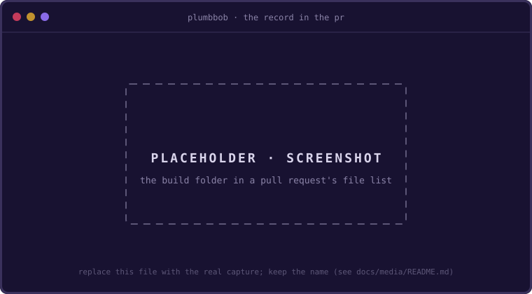

# The Record Is the Why, Beside the Code

Every step has landed, range 3's stop card is still waiting, and `~/.sift.archive.json`
holds a library book and the plants. One move closes the build. **The folder that drove the build is the
one artifact a teammate can read cold.** The chat is gone when the window closes; `git log`
says what changed and when; only the build folder says why, in lines the verbs wrote as
each call was made, not in a summary composed afterward. This lesson finishes the build,
then reads the whole history back from that folder and from git, with the chat closed.
About twenty minutes.

## Finish

Answer the stop card with the finish; it is the card's second move:

```text
/plumbbob:finish
```

The skill records the card first, the way `looks good` would
([D102 (settle-in-one-reply)](../decisions.md#d102)), so range 3's review reaches the
Log before anything else happens:

```text
**Stop**: **Range 3** recorded (nothing parked)
```

Then it writes `report.md` into the build folder from `intent.md` and the Log, and runs
`plumbbob finish`, which appends the checkpoint SHAs and the per-step receipts to that
file, makes the final commit, and clears the control state:

```text
**Session**: finished (b7e4c9d02, .plumbbob/builds/2026-11-04-sift-a-list-that-forgets/ rides your branch into the PR)

| **Next Up** | Nothing planned - /plumbbob:plan |
| --- | --- |
```

Now read what it wrote:

```sh
cat .plumbbob/builds/2026-11-04-sift-a-list-that-forgets/report.md
```

Five sections are the model's: what shipped, the decisions and why, the parks as a table
with the class each settled as (the lean table's shape, `Settled` in place of `Lean`;
[D112 (lean-table)](../decisions.md#d112),
[D125 (linked-park-names)](../decisions.md#d125)), the final status, and the deferred
tangents. Two are the CLI's, appended beneath:

```markdown
## Checkpoints

- baseline 1c0d3a9e2
- plan 7d2e94fb0
- step 1 4b1e9c2d7
- step 2 9f3c1a0b6
- step 3 c27d4e8a1
- step 4 1b8e6f5c3
- step 5 7a4d2c9e8
- step 8 7c2d1e0f4
- step 6 d41a9b3c7
- step 7 2f8e6a1b9

## Stats

| step | red checks | drift warnings | reverts | wall-clock |
| ---- | ---------- | -------------- | ------- | ---------- |
| 1 | 0 | 0 | 0 | 3m |
| 2 | 0 | 0 | 0 | 3m |
| 3 | 0 | 0 | 0 | 4m |
| 4 | 0 | 0 | 0 | 4m |
| 5 | 0 | 0 | 0 | 3m |
| 6 | 0 | 0 | 0 | 3m |
| 7 | 0 | 0 | 0 | 4m |
| 8 | 0 | 0 | 0 | 2m |
| **total** | 0 | 0 | 0 | 26m |
```

The report synthesizes; it does not re-narrate, because the Log already did, step by
step, as each landed. No gate stood between you and the exit: a build with no report
still finishes, with an advisory ([D9 (finish-no-gate)](../decisions.md#d9)).

## Read the History Back

```sh
git log --oneline
```

```text
b7e4c9d chore(sift): finish
2f8e6a1 feat(store): settle what happens to an item that falls off
d41a9b3 feat(cli): give an item the default life when --for is left off
7c2d1e0 feat(life): accept a shelf life written in weeks
7a4d2c9 feat(cli): print what is still alive with bare sift
1b8e6f5 feat(cli): add an item with sift add
c27d4e8 feat(store): keep the list in one JSON file
9f3c1a0 feat(item): tell a live item from one past its life
4b1e9c2 feat(life): parse a shelf life written in days
7d2e94f chore(sift): plan
b31a0c2 docs: add the spec
1c0d3a9 chore: scaffold with checkride
```

Twelve commits: the scaffold, the spec, the plan, eight steps in build order, and the
finish. Each step's subject is its title in `intent.md`, verbatim
([D68 (conventional-subjects)](../decisions.md#d68)), which is why the course kept the
titles under 72 characters. Step 8 sits between 5 and 6, where the order put it, and
nothing was renumbered to make that true. Open it:

```sh
git show --stat 7c2d1e0
```

The body opens on a marker line, `plumbbob step 8`, then the done-when and the seam the
step was built to, so `git log --grep plumbbob` finds every landing, and a reviewer who
reads the commit alone reads the criterion it met.

## Three Decisions, Three Origins

Five Decisions ended the build (more, if lesson 6's refine added any), and three of
them, `D3` to `D5`, came from three different places. Here they are as `intent.md` holds
them; yours carry the model's own reasons:

```markdown
- <a id="d3"></a>**D3 (default-life)**: an item left without `--for` lives 5 days, *because* a work week is as long as I leave a thing before I stop seeing it
- <a id="d4"></a>**D4 (archive-not-delete)**: a fallen item moves to `$SIFT_ARCHIVE`, default `~/.sift.archive.json`, *because* I want to look back once before it is gone (range 2's stop, by hand)
- <a id="d5"></a>**D5 (weeks-are-days)**: `w` is sugar for seven `d`, *because* the store keeps days and the parser stays one function (step 5's boundary, P2)
```

`D3` came from the plan card and your pen. `yes to all leans` resolved `Q1` and the skill
wrote the line with 7 in it; you changed the 7 to 5 by hand before the plan was
committed, so the Log's first entry carries the date and the plan commit carries your
number:

```sh
git show 7d2e94f -- .plumbbob/ | grep default-life
```

`D4` came from your pen alone, at range 2's stop, in lesson 6. The parenthetical says so
because you wrote it; nothing else in the record would, which is why the convention asks
for the origin in the line.

`D5` came from a harvest, and three places hold its trail. The Park list holds the line
as you parked it:

```markdown
- [x] 2w is refused by the parser, and weeks are how I think about passports (tangent)
```

The Harvest section holds the class and the date:

```markdown
- 2026-11-04, at the step 5 boundary: 1 parked idea, classified.
- **blocker**: park 2 · 2w is refused by the parser, and weeks are how I think about passports (tangent) → step 6 stores a life and step 7 judges one past, and both would document a unit the parser refuses
```

And git holds the moment it entered the plan, since the harvest's edit rode the next
checkpoint, step 8's:

```sh
git log -S weeks-are-days --oneline -- .plumbbob/
```

```text
7c2d1e0 feat(life): accept a shelf life written in weeks
```

Three origins, one shape: a number, a slug, a because, and where it was decided. A cold
reader never has to ask who.

## In the Pull Request

The folder is tracked, so it rides the branch into the pull request beside the source it
describes ([D26 (build-folders)](../decisions.md#d26)): `intent.md`, `build-log.md`,
`checkpoints`, `stats.json`, `report.md`, and `spike-01-days-or-date.md`. A reviewer who
opens the file list sees the plan as it ended, the log as it was written, and the report;
a reviewer who wants to know why step 8 exists reads it without asking you. A squash
merge collapses the twelve commits and leaves the folder in `main`.



What never ships is the control plane: `STATE`, `TURN`, `GRANT`, `detail.md`, and the
markers under `.plumbbob/`, excluded through `.git/info/exclude` and cleared by the
finish. The folder is the record; the control plane was the clock.

## With Your Agent

> Using only the build folder and git log, not our chat, tell me why step 8 exists, who
> decided, and when. Quote the lines.

Check that it finds four things: the Park list line, the Harvest line with its class,
`D5 (weeks-are-days)` with its because and its origin, and the re-cut range,
`/plumbbob:build 8,6-7` under `## Build ranges`. The when comes from the Harvest line's
date and step 8's line in the Log. An answer that says you told it in the chat has not
done the exercise.

## Try It

1. `/plumbbob:status` now prints `NO ACTIVE SESSION`: the control plane is empty while
   the folder is whole. Nothing to put back.
2. Read the control-plane table in [`state-and-git.md`](../state-and-git.md) and list the
   files that were never committed. Then run `git ls-files .plumbbob/` and check your list
   against what git tracks; `settings.json` is there, from lesson 0's scaffold.

## Remember

- The record is written by the verbs as the build goes, not by anyone after the fact.
- Every Decision carries its because and its origin, so "who decided, and when" is a grep.
- `finish` commits the folder, so the why ships with the code.

[← When the Design Will Not Settle](./07-spike-and-revert.md) · [The CLI Is the Whole Loop, Typed →](./09-by-hand.md)
