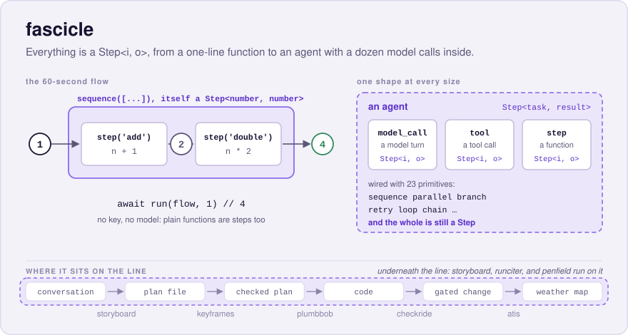
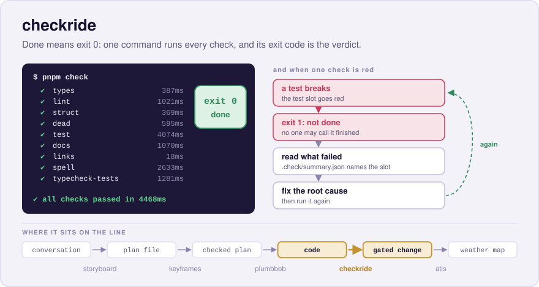

# Where PlumbBob Sits

The tools around plumbbob form a line of hand-offs. Each one reads one artifact and writes
the next, and a person signs each: a conversation becomes a plan file, the plan file
becomes a checked plan, the checked plan becomes code a step at a time, the code becomes a
gated change, and the gated change becomes a weather map a reviewer reads in ten seconds.
plumbbob is the middle of the line, where a signed plan becomes code. This page walks the
line once, one paragraph, one picture, and one sixty-second moment per tool, in the order
the artifacts flow; the versions are as of 2026-11-05. Each picture ends on the same strip,
the line itself, with that tool's hop lit. About ten minutes.

## storyboard

**storyboard interviews a person the way twenty questions works**, open and broad first,
then narrow, until it knows enough to draft, and what it drafts is `keyframes.md`: the file
the next tool checks and the file plumbbob plans from. A person corrects the draft; nothing
is signed blind. It is young: 0.2.0, tagged on 2026-11-02, was the first release, and what
runs today is the new-project interview and the intent output, with the spec and design
lenses still to come. It needs a local model on Ollama and the `claude` CLI, so for a room a
recording is the safer demo. It is not on npm yet; it runs from a clone of
[`robmclarty/storyboard`](https://github.com/robmclarty/storyboard), linked onto your PATH.


**In 60 seconds:** in an empty folder, `storyboard turn` prints intake's three questions;
pipe answers in and the next round prints.

```sh
mkdir ~/learn/board && cd ~/learn/board
storyboard turn
```

## keyframes

**One file people set, and everyone who works on the project, human or agent, works from
it.** `keyframes.md` holds intent, constraints, map, and decisions, each cited by ID, and a
`held-by:` pointer on a constraint names the rule or test that holds it; `keyframes check`
proves every pointer resolves. It is a prototype at 0.3.0 whose pilots were stopped before
they ran, and its README says so. plumbbob keeps one at its root anyway,
[`keyframes.md`](../../keyframes.md), wired into `pnpm check` as the `intent` slot; the
trial that never ran is [`keyframes-split-trial.md`](../keyframes-split-trial.md).


**In 60 seconds:** in a clone of plumbbob, open `test/e2e/build-loop.test.ts` and shorten
the title of the test `mid-step park lines survive a revert` by one word, then run the
check and put the test back:

```sh
pnpm exec keyframes check --strict
git checkout test/e2e/build-loop.test.ts
```

```text
constraints   7 · 5 linked · 1 review · 1 broken

keyframes.md:78  error  broken-pointer  file:test/e2e/build-loop.test.ts#"mid-step park lines survive a revert" doesn't contain that text; fix it, or add "(new)" if it's planned

1 error
```

Exit 1. A pointer resolves; it is never enforced: the test still runs in its own slot of
the same gate, and the check knows only that the plan no longer names it.

## plumbbob

**The plan is a file you keep true, and every change to it leaves its why beside the
code.** That is what the course did: lesson 2 wrote `intent.md` and committed it alone,
lessons 3 and 4 landed steps only when you said so, lesson 5 met a surprise the plan never
covered and folded it in without losing plumb, and lesson 8 read the whole history back
from the build folder and `git log`. Beside it sits
[ridgeline](https://github.com/robmclarty/ridgeline), the layer above: where plumbbob keeps
you in the driver's seat, ridgeline runs large, settled work without you, through a phased
pipeline of agents; its last release was 0.12.14, on 2026-06-12.


**In 60 seconds:** the lesson 5 sequence. `sift add "renew passport" --for 2w` is refused,
`/plumbbob:park` writes one line, `/plumbbob:harvest` at the boundary proposes a blocker,
`looks good` appends a Decision and a step and re-cuts range 3, and
`**Build ranges**: range 3 of 3 re-cut (steps 8,6-7)` is the line to watch for.
[Lesson 5](./05-park-and-harvest.md) has every card.

## runciter

**runciter is a personal, event-sourced control plane for agentic work.** It moves a task
through Capture, Analysis, Approved, Build, Review, Merge, and Done, runs each stage's agent
as a supervised child process, builds in an isolated git worktree, verifies with the target
repo's `pnpm check`, and stops at the gates where you decide. Its spec's glossary names
plumbbob as "the methodology the human gates implement": a human between machine phases,
the same pause the course read at every card. It is private, at 0.4.2 as of 2026-11-05,
so no link.


**In 60 seconds:**

```sh
runciter capture "Add a word counter" --repo .
```

The task id prints, and the card lands in the board's Capture column; drag it to the next
column and open its drawer.

## fascicle and penfield

**Underneath the agents sits fascicle, where everything is a `Step<i, o>`.** storyboard,
runciter, and penfield run on it (plumbbob does not; fascicle is a devDependency there,
for the eval driver only), and it is at 0.17.8. One shape, from a one-line function to an
agent with a dozen model calls inside it, is the shape this course borrowed its lessons
from. Penfield is the model gateway under those: "dial a setting, get the state you need",
and a Claude target is a decision, not an execution. Its Stage A runs through its spec's
step 16 as of 2026-11-01, and its `stage-a` build folder, with decisions added at harvests
and live stops, is a real example of what lesson 8 showed. On npm as
[`fascicle`](https://www.npmjs.com/package/fascicle); penfield is on GitHub at
[`robmclarty/penfield`](https://github.com/robmclarty/penfield).




**In 60 seconds:** fascicle's `examples/hello` shape, which needs no key:

```ts
import { run, sequence, step } from 'fascicle'

const flow = sequence([step('add', (n: number) => n + 1), step('double', (n: number) => n * 2)])

console.log(await run(flow, 1))
```

```text
4
```

Penfield's moment is a `curl` against the gateway with `"model":"auto"`, then
`/decisions?limit=5` through `jq` to read why it routed where it did; that needs the LAN,
so record it.

## checkride

**Done means exit 0.** checkride is the gate every tool on this page aliases,
`"check": "checkride"` in each repo, and plumbbob's pause measures it at every step; the
plugin bundles its own copy and runs it in-process against the config your repo wrote.
Since plumbbob 0.14.1 that copy is the current release, 0.20.0, on 2026-11-05, with
language packs for ts, go, rust, python, terraform, bash, and odin. On npm as
[`checkride`](https://www.npmjs.com/package/checkride).



**In 60 seconds:** lesson 0 again.

```sh
pnpm dlx checkride@0.20.0 init --shape flat --name sift
pnpm install
pnpm check
```

```text
✔ all checks passed in 4468ms
```

Break a test and run it again: exit 1, and a short digest of the failing slot prints last
on stderr.

## atis

**A weather map for a change.** atis reads git, checkride's `.check/`, and fallow, and
tells you where to look: you read the weather in ten seconds, then go in only where it is
bad. checkride gates, atis informs, and it never blocks. It is not yet published, so the
only link is GitHub, [`robmclarty/atis`](https://github.com/robmclarty/atis).


**In 60 seconds:**

```sh
pnpm check
atis --last-commit
```

A tab opens on the repo as a dark planet with the change lit, and a block reads VFR when
the change can be merged on a glance.

Volley and the memory daemon are left out of this line on purpose. A demo reel that runs
the whole line on one repo, end to end, is parked as its own project.

[← The CLI Is the Whole Loop, Typed](./09-by-hand.md) · [Back to the course map](./README.md)
